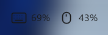
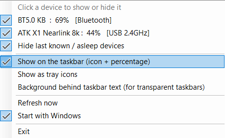

# BatteryTray

Ứng dụng Windows nhẹ hiển thị trực tiếp biểu tượng và phần trăm pin của chuột, bàn phím không dây ngay trên thanh Taskbar.

## Giao diện thực tế

| Hiển thị trên Taskbar | Menu điều khiển & danh sách thiết bị |
| :---: | :---: |
|  |  |

## Tính năng chính
- Hiển thị trực tiếp `[Icon thiết bị + % pin]` cạnh khay hệ thống Windows 10/11 hoặc thu gọn thành icon trong System Tray.
- Hỗ trợ mọi thiết bị ngoại vi kết nối qua **Bluetooth** (chuẩn Windows PnP Battery Service).
- Hỗ trợ đọc phần trăm pin qua đầu thu **USB 2.4GHz** cho:
  - **ATK** (đầu thu Nearlink 8K `VID_373B&PID_108C`).
  - **Logitech** (đầu thu Lightspeed, Logi Bolt, Unifying `VID_046D` theo chuẩn HID++ 2.0).
  - **Razer** (đầu thu HyperSpeed / Wireless `VID_1532` theo giao thức OpenRazer 90-byte).
  - **Darmoshark, Ajazz, Zaopin, Delux** (nhóm đầu thu dùng chip Compx `VID_3554` / `VID_25A7`).
  - Các hãng khác sẽ tiếp tục được cập nhật trong những phiên bản sau.
- Xây dựng theo kiến trúc mô-đun `IBatteryProvider`, thuận tiện để mở rộng thêm giao thức của các hãng mới.

## Cài đặt
Tải tệp cài đặt mới nhất tại mục **Releases** bên phải và chạy trình cài đặt.
